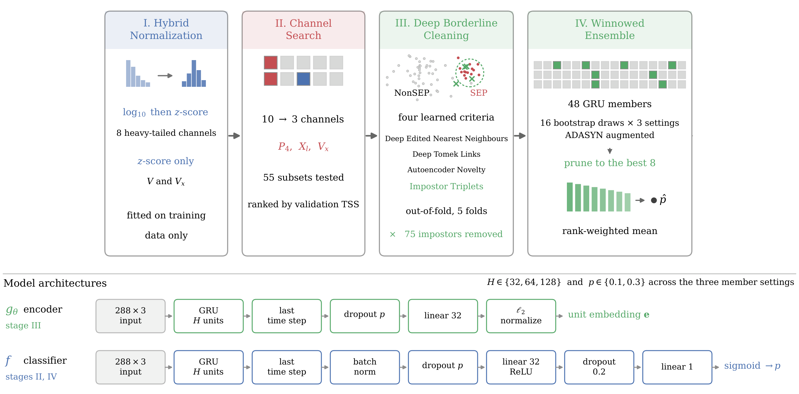
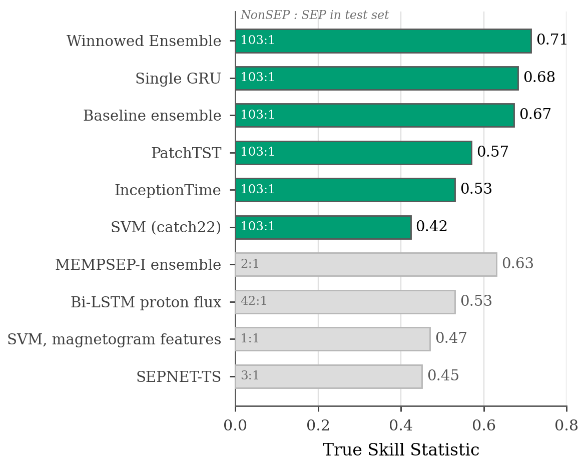
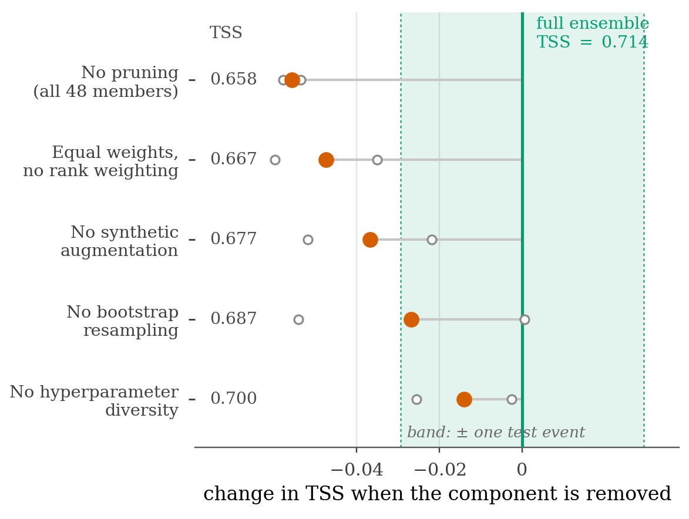

# Solar Energetic Particle Forecasting with Deep Borderline Cleaning and Ensemble Pruning

Code and data for the paper — an end-to-end pipeline that forecasts Solar Energetic Particle (SEP) events from pre-flare multivariate time series under a `103:1` class imbalance.

---

## Abstract

Solar energetic particle (SEP) events are the space weather phenomenon that most directly threatens human activity beyond low Earth orbit, delivering ionizing radiation doses to crews and inducing upsets in spacecraft electronics on timescales too short for reactive mitigation. Yet SEP forecasting remains among the least reliably solved problems in the field.

We make four contributions to high-skill SEP forecasting using a multi-instrument OMNI/GOES catalog of 17,794 pre-flare multivariate time series: **hybrid normalization**, a per-channel scheme fitted only on the training partition; **skill-driven channel subset selection**, a wrapper-based procedure evaluated using the downstream classifier’s True Skill Statistic (TSS) that reduces ten instrument channels to three; **deep borderline cleaning**, four novel methods, Deep Edited Nearest Neighbours, Deep Tomek Links, Autoencoder Novelty Detection, and Impostor Triplets, that identify and remove ambiguous NonSEP training examples that closely resemble SEP events; and the **Winnowed Ensemble**, a pruned bagging architecture that diversifies members along three independent axes, retains the strongest candidates, and combines their predictions using a rank-weighted average.

---

## Pipeline

<p align="center"></p>

Each stage is one notebook. Skill accumulates as follows, all measured on the same held-out test partition:

| Stage | TSS |
|---|---|
| No preprocessing, raw inputs | −0.19 |
| \+ hybrid normalization | 0.63 |
| \+ channel search (`P4, Xl, Vx`) | 0.65 |
| \+ Impostor Triplets cleaning | 0.68 |
| \+ Winnowed Ensemble | **0.71** |

The single largest effect is not a modelling choice but a normalization choice: the GRU swings 0.82 TSS across normalization schemes, against 0.27 across architectures.

---

## Results

### Against published SEP forecasters

<p align="center"></p>

Only TSS and PoD are comparable across studies — every published model is evaluated on its own partition, with class balances from `1:1` to `42:1` against `103.7:1` here. Precision and accuracy are strongly balance-dependent and are not comparable.

### Which ensemble components matter

<p align="center"></p>

Removing one component at a time from the Winnowed Ensemble. Pruning is the largest single effect (−0.056 TSS), followed by rank weighting (−0.047). The shaded band is what one reclassified test event is worth on a 34-event partition (0.029 TSS) — the bottom two rows fall inside it and should not be read as established.

---

## Dataset

`dataset/` holds ten instrument channels, one gzipped CSV each. Every row is one event: a label plus a 288-step series covering the 24 hours before flare onset at 5-minute cadence.

| Source | Channels |
|---|---|
| OMNI | `V`, `Vx`, `Np`, `Tp`, `F` |
| GOES | `Xl`, `Xs`, `P4`, `P5`, `P6` |

Stacked, this is an array of shape `(17794, 288, 10)`.

| Split | Instances | NonSEP | SEP | Ratio |
|---|---|---|---|---|
| Train | 12,455 | 12,337 | 118 | 104.6:1 |
| Validation | 1,780 | 1,763 | 17 | 103.7:1 |
| Test | 3,559 | 3,525 | 34 | 103.7:1 |
| **Total** | **17,794** | **17,625** | **169** | **104.3:1** |

With only 34 SEP events in the test partition, **one reclassified event moves TSS by 0.029**. Differences smaller than that are not resolvable, and the paper reports them as such.

The CSVs are stored gzipped (74 MB compressed, 697 MB raw) because two of them exceed GitHub's file-size limits uncompressed. **Decompress before running notebook 1:**

```bash
gunzip -k dataset/*.csv.gz
```

---

## Installation

```bash
git clone https://github.com/samresume/SEP_Ensemble_Triplets.git
cd SEP_Ensemble_Triplets
python3 -m venv .venv && source .venv/bin/activate
pip install -r requirements.txt
```

Core dependencies: `numpy`, `pandas`, `scikit-learn`, `imbalanced-learn`, `sktime` (catch22 features for the SVM), `torch`, `transformers` (PatchTST), `matplotlib`, `seaborn`.

Training runs on CUDA, Apple Silicon MPS, or CPU — the notebooks select the device automatically. On macOS the notebooks set `KMP_DUPLICATE_LIB_OK=TRUE` and `OMP_NUM_THREADS=1` before importing torch, because mixing the MPS backend with scikit-learn's threaded neighbour search in one process can segfault.

---

## Running the notebooks

Run them in order — each consumes the previous one's output. Notebooks 5 through 9 are the expensive ones. `results/` and the `final_split_data_*/` folders are created on the first run; neither is shipped with the repository.

| # | Notebook | Consumes | Produces |
|---|---|---|---|
| 1 | `1_DataPreparation.ipynb` | `dataset/*.csv` | `final_split_data_*/` for five normalization schemes |
| 2 | `2_FeatureSelection.ipynb` | hybrid-normalized split | `..._BestFeatures/`, `results/gru_feature_selection_sfs.txt` |
| 3 | `3_BorderlineCleaning.ipynb` | best-channel split | four cleaned training sets, including `..._Siamese/` (Impostor Triplets) |
| 4 | `4_GRUComparison.ipynb` | all five training sets | `results/gru_comparison.txt` |
| 5 | `5_EnsembleGRU.ipynb` | `..._Siamese/` | `results/gru_baseline_ensemble*.txt` |
| 6 | `6_WinnowedEnsemble.ipynb` | `..._Siamese/` | `results/ensemble_gru_adasyn_*.txt` |
| 7 | `7_ArchitectureComparison.ipynb` | `..._Siamese/` | `results/architecture_comparison.txt` |
| 8 | `8_Figures.ipynb` | `results/` | every figure in `figures/` |
| 9 | `9_EnsembleAblation.ipynb` | `..._Siamese/` | `results/ensemble_ablation.txt` |

---

## Repository layout

```
├── 1_DataPreparation.ipynb  …  9_EnsembleAblation.ipynb
├── dataset/              ten gzipped channel CSVs
├── figures/              figures produced by notebook 8
├── requirements.txt
└── LICENSE
```

---

## License

Released under the MIT License — see [LICENSE](LICENSE).
